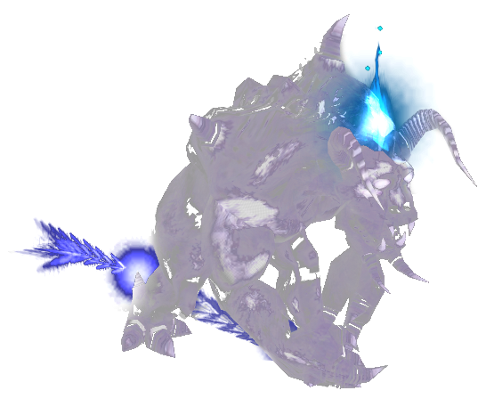
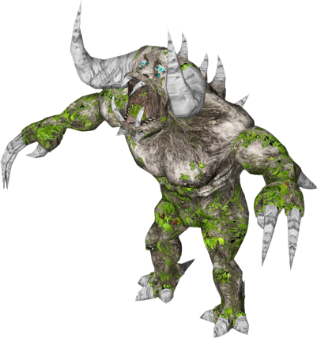
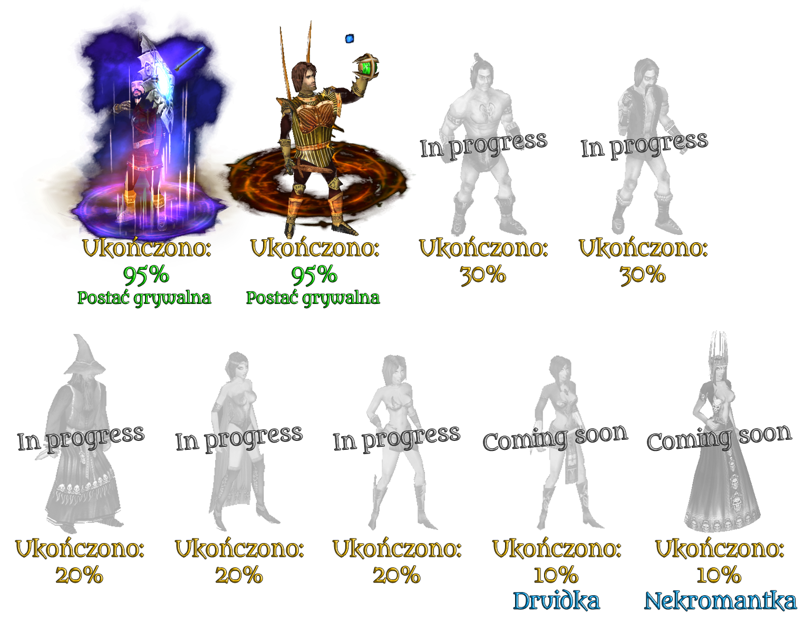
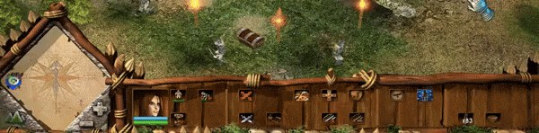
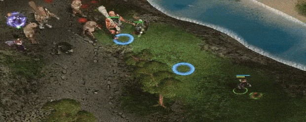
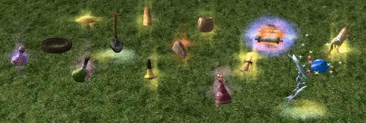

# Gold Edition

# Mod Update & Features Changelog

* Hundreds of new enemies in RPG mode,
* Constantly added spells,
* Expanded map editor,
* New soundtracks,
* 16 new RPG maps,
* 10 new RTS maps,
* 9 Adventure maps,
* New/refreshed textures,
* New RPG interface,
* New game modes,

* Constantly expanding translation,
* Continuously modified RPG mode and ongoing balance work,
* Many new mechanics,
* Greater customization of RPG characters,
* Unique collectible figurines to gather,
* New items in RPG mode,
* Thousands of new objects,
* New bot difficulty levels,
* Completely refreshed classic RTS campaign,
* Refreshed shaders and graphical improvements,
* Ongoing support and updates,
* And much, much more!

---
## RPG Mode Remaster

---

### Refreshed Interface
The RTS and RPG game interfaces have been adapted for 16:9 monitors.

### New Skills and Spells
RPG characters that previously had no spells have been given mana and a full arsenal of unique abilities useful in combat against enemies.

### Items
New items have been added to RPG mode, such as decoctions, food, scrolls, stat-increasing statues, and a shovel that can be used to dig up hidden treasures.

### New Skills:
* **Knowledge** – The character can add skill points using knowledge scrolls,
* **Agility / Lightness** – The character performs attacks at full speed at the cost of health,
* **Critical Strike** – Magic characters have a percentage chance to critically strike.

### New Spells:
* **"Light Self-Heal"** for non-magic characters,
* **Hunter** – Arrow Sacrifice, Arrow Rain, Fire Ballista, Leech Arrow, Stun, Summon Wolf Spirit,
* **Knight** – Armor Boost, Whirlwind, Stun, Speech, Summon Stone Golem.
* Spells can be reset, refunding skill points.

* Spells for AI enemies in RPG mode,
* Food mechanic – characters do not regenerate health automatically. Edible items have been introduced,
* Regenerative elixirs and all inventory items now have a required level (lvl),
* Rebalance of all RPG elements.

---

### Media
* ["KnightShift - Destruction Physics"](https://www.youtube.com/watch?v=JYyBTV5oxYY)
* ["Polanie II (KnightShift) Fanmade Gold Edition 2.8.0 - 'Tale of the Curse of Souls'"](https://www.youtube.com/watch?v=V24IOaTwyrI)

---

### Important Notes:
* Old RPG characters are **not compatible** with the latest version of the game. 
* Remember (if you have the physical version of the game) to remove the CD from your computer's drive.
* If you want to play RPG mode, please **create a new player account**. Entering RPG mode on an old account may cause the game to crash.
* The only original download link for the mod is located on this page / Steam guide, or on ModDB. We are not responsible for content downloaded from other sites.

---

| Version | Release Date | Download Link |
| :--- | :--- | :--- |
| ver. 2.00 | 01.02.2021 | - |
| ver. 2.1 | 20.02.2021 | - |
| ver. 2.2 | 10.03.2021 | - |
| ver. 2.3 | 01.04.2021 | - |
| ver. 2.4 | 01.05.2021 | - |
| ver. 2.5.3 | 19.07.2021 | - |
| ver. 2.5.7 | 17.10.2021 | - |
| ver. 2.6.1 | 22.10.2021 | [drive.google.com](https://drive.google.com) |
| ver. 2.6.2 | 03.01.2022 | [drive.google.com](https://drive.google.com) |
| ver. 2.7.0 | 01.02.2022 | - |
| ver. 2.7.1 | 19.10.2022 | - |
| ver. 2.8.0 | 15.05.2023 | - |
| ver. 2.8.1 | 21.08.2023 | - |
| ver. 2.8.3 | 26.09.2023 | - |
| ver. 2.8.4 | 14.11.2023 | - |
| ver. 2.8.6 | 30.03.2024 | [drive.google.com](https://drive.google.com) |
| ver. 2.8.6 (a) | 25.04.2024 | [drive.google.com](https://drive.google.com) |
| ver. 2.9.0 | 26.08.2025 | [drive.google.com](https://drive.google.com) |

---

# Contributors & Special Thanks

## Contributors
* **Kornel Witkowski** – RTS mode, bots.
* **Mateusz Chojnacki, Nicola Tyszer** – Concept artist, object graphics.

## Special Thanks To:
* **Alanova** – For your kindness, significant help, and your contribution to the development of the modification.
* **Grabka** – For placing the results of your hard work in our hands, we will certainly put them to good use!

*Thank you <3*

---

**Author:** Atalas, Mese, Reset  
**Version:** 2.8.6  
**Type:** Total Conversions / Full Mods
